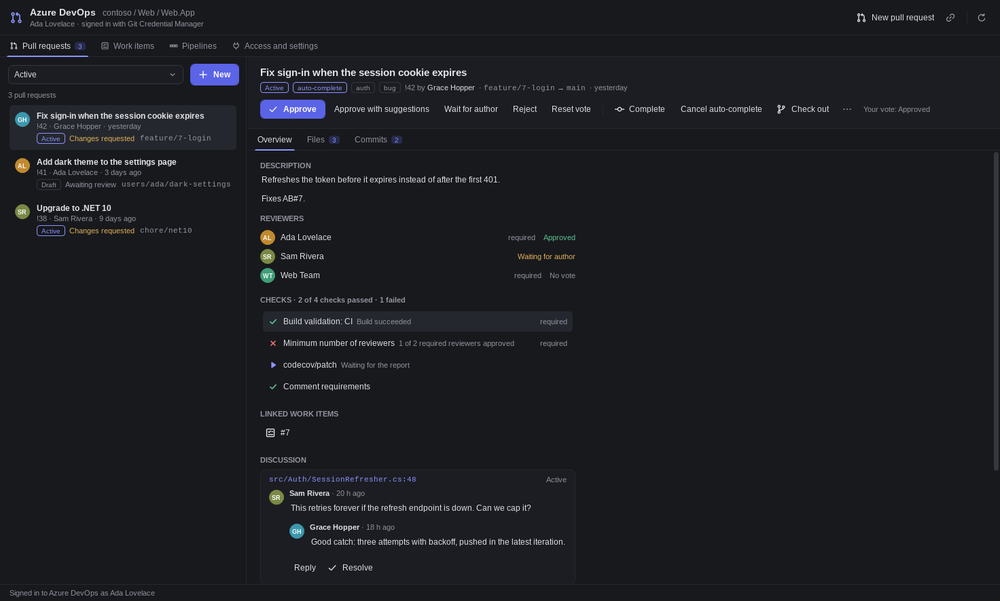
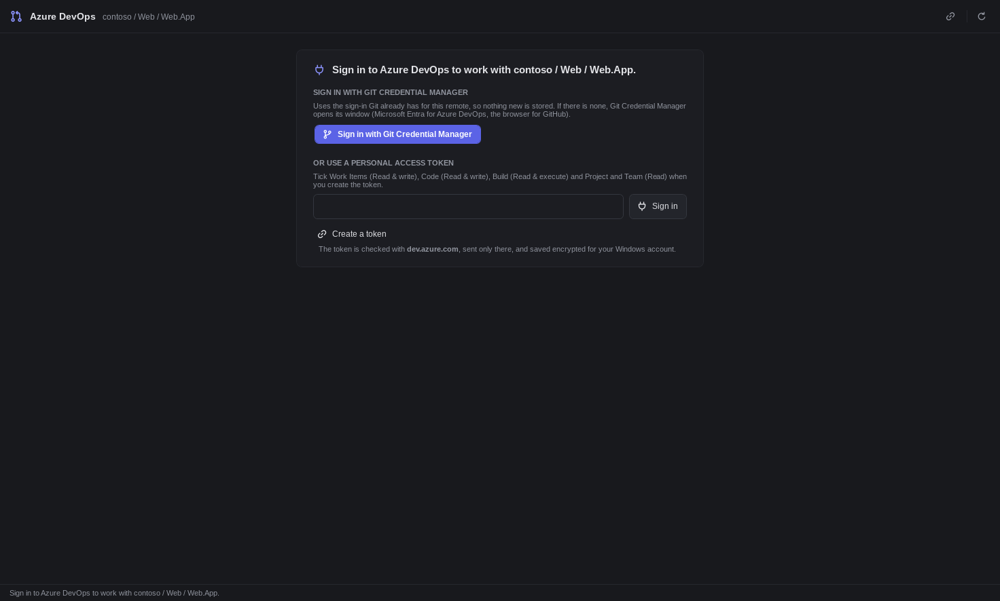
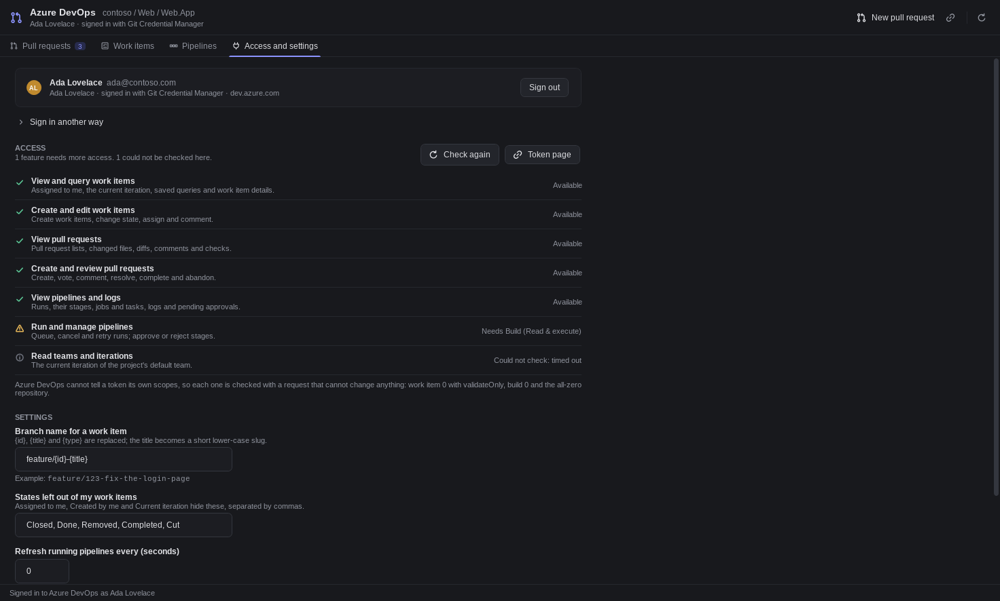
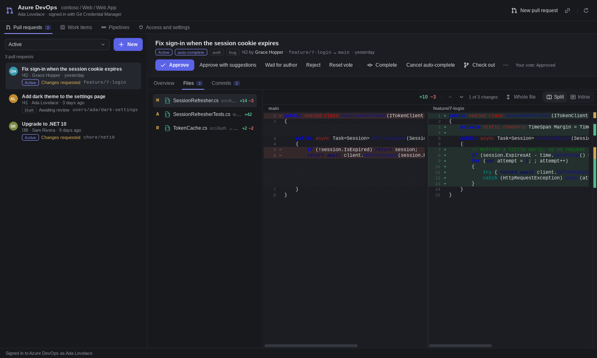
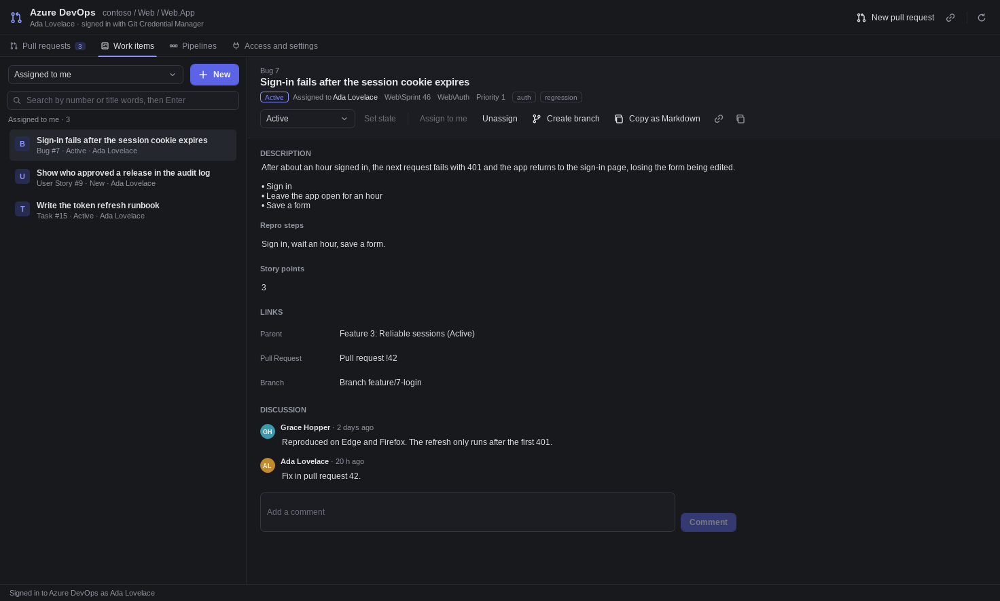
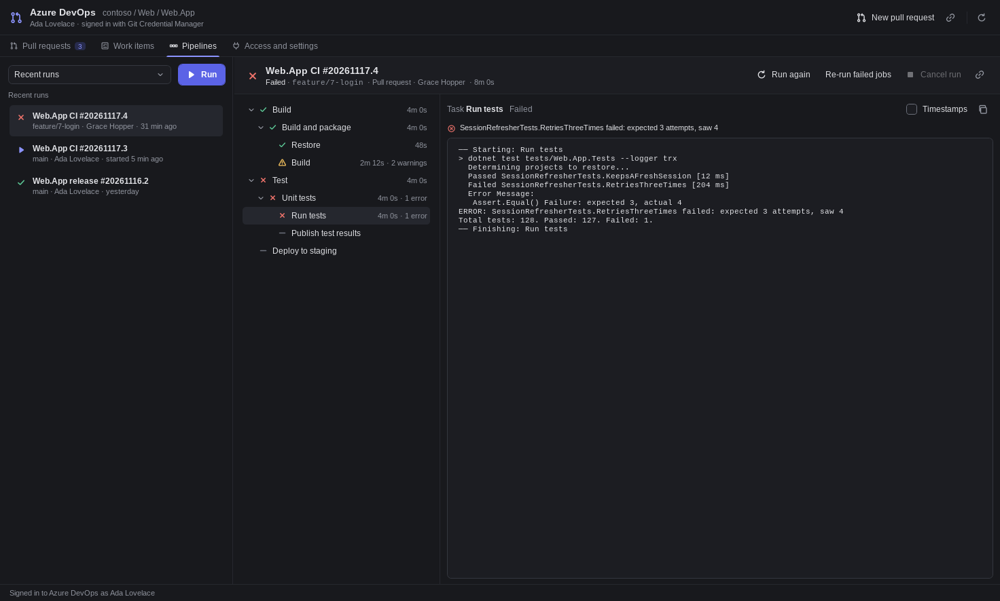

# DevOps workbench

**Tools > DevOps** works with the pull requests, work items and pipelines of the repository the Git pane has open, on **Azure DevOps** (Services and Server) and **GitHub** (github.com and Enterprise Server). On GitHub, work items are **Issues** and pipelines are **Actions**; the workbench uses each service's own words.

The workbench follows the Git pane: its remote decides the service and repository, and its branch decides what **New pull request**, **This branch** and the Git pane's pull request badge refer to. Opening the workbench loads the Git repository if the Git pane has not done so yet. Nothing is sent to the service until the workbench is opened, and every list is read again when you choose **Refresh**; nothing is cached between sessions.

It is also reached from the toolbar (the pull request icon next to Git), the command palette (`DevOps: Pull requests`, `DevOps: Work items`, `DevOps: Pipelines`, `DevOps: Create pull request`, `DevOps: Access and settings`), and the Git pane.

## Signing in

The workbench tries, in order:

1. **A personal access token saved in WpfStudio** for the organization (Azure DevOps) or host (GitHub).
2. **The sign-in Git already has.** It asks Git Credential Manager, without showing anything, for the credential it keeps for the remote's HTTPS address (`git credential fill`). Git Credential Manager stores a Microsoft Entra token for Azure Repos and an OAuth token for GitHub; both work with the REST APIs. So a clone you can fetch from usually needs nothing more. The credential is read when needed and never copied into WpfStudio's files.

When neither is there, the workbench offers both ways to sign in:

- **Sign in with Git Credential Manager** lets it show its window (Microsoft Entra for Azure DevOps, the browser for GitHub), then uses what it stored. Git uses the same sign-in afterwards.
- **Personal access token**: paste it and choose **Sign in**. The token is checked with the service first and saved only when it is accepted, encrypted with Windows data protection for your account, in `%LOCALAPPDATA%\WpfStudio\devops.json`. **Create a token** opens the service's token page.

**Sign out** (on **Access and settings**) removes a saved token from this computer, or stops WpfStudio using Git's sign-in for that organization or host; Git itself keeps using it for fetch and push. A token that expires or is revoked while the workbench is open brings back the sign-in page with the reason.

| Service | Token | What to grant |
| --- | --- | --- |
| Azure DevOps | Personal access token from *User settings > Personal access tokens* | Work Items (Read & write), Code (Read & write), Build (Read & execute), Project and Team (Read) |
| GitHub | Classic token, or a fine-grained token for the repository | Classic: `repo` and `workflow` (and `read:org` for team review requests). Fine-grained: Contents, Pull requests, Issues and Actions, read and write |

### Access

**Access and settings** lists, feature by feature, what the sign-in can do and what to enable for the rest:

- **Azure DevOps** cannot tell a token its own scopes, so each scope is checked with one request that cannot change anything: a read of a field definition, an empty `validateOnly` patch of work item 0, a pull request for the all-zero repository, an update of build 0. A 401 means the scope is missing; anything that got past the scope check (2xx, 400, 404, …) means it is granted. A granted write scope grants its read scope, and a denied read scope denies the write scope on it. This is the same method as the Azure DevOps extension for VS Code and Cursor.
- **GitHub** lists a classic token's scopes in a response header, which the workbench reads. A fine-grained token lists nothing: what it can read is checked by reading the repository, and what it can change is known only when an action uses it.

### Where the token goes

Requests carry the token only to the service's own hosts: for Azure DevOps the organization's paths on `dev.azure.com` and its `vsrm`, `vssps` and `feeds` hosts (or `*.visualstudio.com`, or the Server collection), and for GitHub the API host. A redirect to any other origin is followed without the token; GitHub answers log requests that way, with a pre-signed storage address. Azure DevOps requests ask not to be redirected to an interactive sign-in page. Tokens are never written to a log, the Output pane or an error message.

Requests go through the proxy chosen in **Settings > Network**, as the API client's and ColtonGPT's do. Git Credential Manager, which signs in through Git, uses Git's own proxy setting.

## Pull requests

**Pull requests** lists the repository's active requests, the ones you created, the ones assigned to you for review (*Review requested* on GitHub), and completed (*Merged*) and abandoned (*Closed*) ones. Each shows its author, age, state, review state and source branch.

Selecting a request shows:

- **Overview**: the description, reviewers and their votes (required reviewers are marked), checks (build validation, branch policies and status checks on Azure DevOps; check runs and commit statuses on GitHub), linked work items (select one to open it in **Work items**), and the discussion. Comments on a file show its path and line. Reply to a thread, resolve it or reactivate it (Azure DevOps), or add a comment to the request.
- **Files**: each changed file with its line counts; select one to see both versions in the same side-by-side diff the Git pane uses. Double-click opens your working copy of the file. On GitHub the base side is the merge base, as GitHub's own diff shows it.
- **Commits**: the request's commits.

What can be done to it:

| Action | Azure DevOps | GitHub |
| --- | --- | --- |
| Review | Approve, Approve with suggestions, Wait for author, Reject, Reset vote | Approve, Request changes (asks what to change, posted with the review) |
| Complete | **Complete** with a merge type (squash, merge, rebase and fast-forward, semi-linear), delete the source branch, complete linked work items | **Merge** with squash, merge commit or rebase, then delete the branch |
| Auto-complete | Set or cancel; completes once every required policy passes | Not offered |
| Draft | Publish, or mark as a draft | Publish, or convert to a draft |
| State | Abandon, Reactivate, Rename | Close, Reopen, Rename |
| **Check out** | Fetches the source branch and switches to it through the Git pane | The same; a request from a fork is fetched from `refs/pull/N/head` into a local `pr/N` branch |

Completing names the source commit the request was shown with, so a push made since is refused instead of merged unseen; refresh and review it first. Checking out needs a clean working tree, like every switch in the Git pane, and runs as the Git pane's action, so its output and any sign-in prompt appear there.

The Git pane's header shows the current branch's active pull request (`!42 · Active · 1 approval`); click it to open the request here.

### New pull request

**New pull request** (in the workbench, in **Tools > DevOps**, or the Git pane's **Create pull request** once you are signed in here) starts from the Git pane's branch, filled in:

- **Into**: the repository's default branch.
- **Title**: the commit's subject when the branch has one commit, else a title made from the branch name (`feature/123-fix-login` reads *Fix login*).
- **Description**: the subjects of the branch's commits that the target lacks, as a list.
- **Work items**: the number a branch segment starts with (`feature/123-…`, `users/ada/123_…`) and the ones its commits mention (`#123`, `AB#123`). On Azure DevOps they are linked to the request; on GitHub a `Resolves #123` line is added to the description for each one it does not already mention.
- **Create as a draft**, and on Azure DevOps **Set auto-complete**.

When the branch is not on the remote, or has commits the remote lacks, the form offers **Publish branch** or **Push** (through the Git pane) first. When the branch already has an active request, the form says so and opens it instead.

## Work items and issues

| | Azure DevOps | GitHub |
| --- | --- | --- |
| Lists | Assigned to me, Current iteration (of the project's default team), Created by me, Recently changed by me (14 days), and your saved queries (My Queries and Shared Queries, including tree queries) | Assigned to me, Created by me, Mentioning me, All open issues |
| Search | A number, or words of the title | A number, or GitHub's issue search |
| States | The work item type's states | Open, Closed |

The personal Azure Boards lists leave out the states named in **Access and settings** (Closed, Done, Removed, Completed and Cut by default).

An item shows its type, state, assignee, iteration (milestone on GitHub), area, priority and tags, its description, repro steps, acceptance criteria and effort, its links (parent, children, related, pull requests, branches, commits; select a linked work item to open it), and its discussion. Descriptions and comments stored as HTML are shown as plain text; nothing from the service is run or rendered as markup.

- **Set state** and **Assign to me** / **Unassign**. On Azure DevOps a change is sent with the revision the item was read at, so a change someone else made meanwhile is reported instead of overwritten.
- **Comment**.
- **Create branch** makes and switches to a branch named from a template (`feature/{id}-{title}` by default; `{id}`, `{title}` and `{type}` are replaced, the title as a short lower-case slug) through the Git pane. A pull request from it links the work item by itself.
- **Copy as Markdown** copies the item, its fields, description and latest comments, to paste into ColtonGPT, a commit message or a chat.
- **New** creates a work item of a chosen type (an issue on GitHub), assigned to you unless you clear the box.

## Pipelines and Actions

The lists are **Recent runs**, **My runs**, **This branch** (the Git pane's branch), **Pipelines** (*Workflows* on GitHub) with each one's latest result, and on Azure DevOps **Pending approvals**. On Azure DevOps the lists hold the pipelines and runs of this repository.

Selecting a run shows its stages, jobs and tasks (jobs and steps on GitHub) with their state, duration, and error and warning counts. A failed run opens on the step that failed. Selecting a step shows its issues and its log:

- timestamps are left out unless **Timestamps** is ticked;
- `##[group]`, `##[section]`, `##[error]`, `##[warning]` and `##[command]` markers become headings and labels, and terminal colour codes are removed;
- a log longer than a million characters shows its end, where a failure is, and says how much was left out;
- on GitHub a step's log is its job's log, as GitHub keeps one log per job.

A run that is queued or running is read again every 15 seconds (change it, or turn it off with 0, in **Access and settings**) until it finishes; the log of a step that is still running is read again with it.

- **Run** queues the selected pipeline (or the selected run's) on a branch you choose, the Git pane's by default. On GitHub the workflow must have a `workflow_dispatch` trigger; GitHub does not name the run it starts, so it appears in the list a moment later.
- **Run again**, **Cancel run**, **Re-run failed jobs**.
- **Approve** and **Reject** a stage waiting for approval, with a comment (Azure DevOps).

## Settings

**Access and settings** holds the branch name template, the work item states the personal lists leave out, the refresh interval for running pipelines, whether logs keep their timestamps, and whether completing a pull request deletes its source branch and completes its work items by default. They are saved in `devops.json` beside the saved tokens.

## Azure DevOps Server and GitHub Enterprise

An Azure DevOps Server remote (`https://server/tfs/Collection/Project/_git/Repo`, or `https://server/Collection/…`, over HTTPS or SSH) is recognized with its collection, and REST version 7.0 (Server 2022) is used for it; Azure DevOps Services uses 7.1. A GitHub Enterprise Server remote (`github.contoso.com`) uses that host's `/api/v3` and `/api/graphql`.

## Limits

- Comments are added to a pull request as a whole or as replies; starting a new thread on a line of the diff is done on the web.
- Reviewers, labels and linked work items of an existing pull request, and work item fields other than state and assignee, are changed on the web. People search is not offered.
- GitHub review threads cannot be resolved, auto-merge cannot be set, and deployment approvals are not listed: GitHub offers these through GraphQL or environments the workbench does not use yet.
- Classic Azure DevOps release pipelines, wikis, test plans and artifacts are not shown.
- Administration (repository settings, branch policies, pipeline editing, boards and backlogs) stays on the web.
- GitLab and Bitbucket remotes keep the Git pane's web links; the workbench explains that it does not serve them.

## How it is built

The services sit behind one interface, `IDevOpsProvider` in `src/WpfStudio.Core/DevOps`, with a provider for each (`AzureDevOps/AzureDevOpsProvider*.cs`, `GitHub/GitHubProvider*.cs`) and a shared HTTP client (`DevOpsRestClient`) that applies the token rules above. The providers and their parsing of remotes, scopes, timelines, logs and work item text live in `WpfStudio.Core`, which builds and tests on any operating system; `tests/WpfStudio.Core.Tests/DevOps` runs them against a scripted HTTP service. The workbench's view models and views are in `src/WpfStudio.App/Features/DevOps`; it reaches Git only through the Git pane's view model (`RunToolActionAsync`) and `GitService`, so its Git actions are the Git pane's one action at a time, with the Git pane's output and sign-in.
